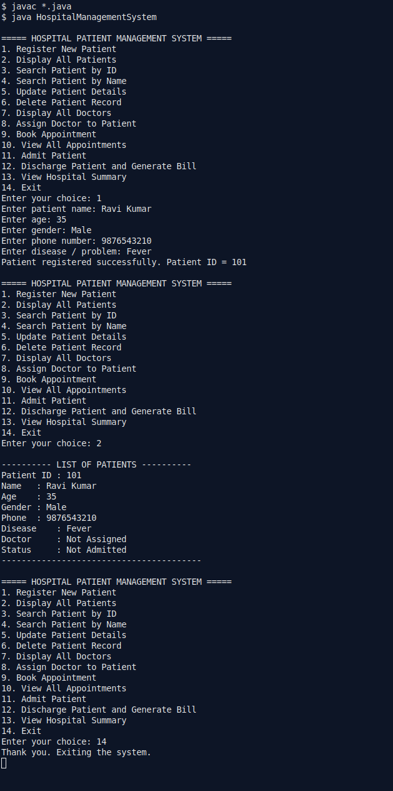
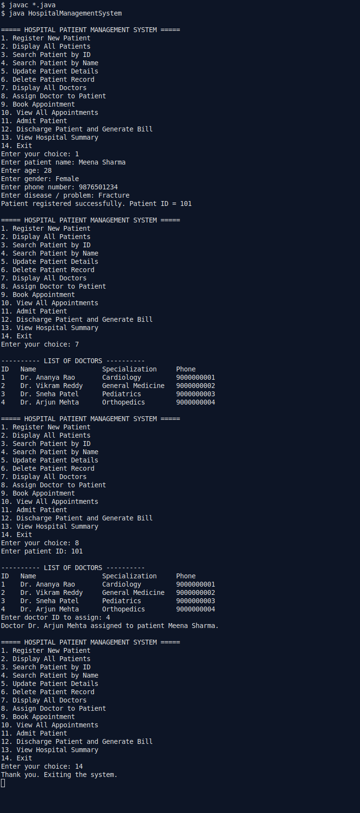
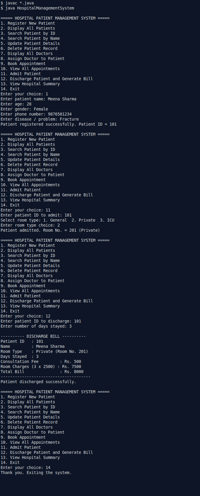

# Hospital Patient Management System

A menu-driven **console application in Java** that computerises the basic patient-record work of a hospital: patient registration, doctor assignment, room admission, and discharge with automatic billing. It replaces manual paper registers, in which searching for a record is slow and billing mistakes are common.

Developed as a B.Tech Course End Project for the **Object Oriented Programming Laboratory**, Vardhaman College of Engineering, Hyderabad. The code uses only basic-to-intermediate Java and the Java standard library — no database, no GUI, no external dependencies.

## Features

1. **Register a new patient** — name, age, gender, phone number and disease are recorded; the program assigns a unique patient ID automatically (starting from 101). Age is validated (must be a number between 1 and 120).
2. **Display all registered patients** with their complete details and current status.
3. **Search a patient by ID** — prints the record, or a clear "not found" message for a missing ID.
4. **Display all doctors** with their specializations (four sample doctors are loaded at start-up).
5. **Assign a doctor to a patient** by patient ID and doctor ID.
6. **Admit a patient** into a General, Private or ICU room; the next room number is assigned automatically (starting from 201). An invalid room-type choice cancels the admission, and a patient who is already admitted cannot be admitted again.
7. **Discharge a patient and generate the bill** (formula below). Discharge is refused for patients who are not admitted, and the number of days must be at least 1.
8. **Safe input handling and exit** — non-numeric input at any prompt is rejected with a message (the program never crashes), invalid menu choices are reported, and option 8 exits cleanly.

### Billing formula

```
Room charge per day : General = Rs. 1,000 | Private = Rs. 2,500 | ICU = Rs. 5,000
Consultation fee    : Rs. 500 (fixed)
Total bill          = 500 + (room charge per day × number of days stayed)
```

Example: Private room, 3 days → 500 + (3 × 2500) = **Rs. 8000** (verified in Test Run 1).

## Prerequisites

- Java Development Kit (JDK) 8 or newer (developed and tested on OpenJDK 17)
- A terminal / command prompt
- Any text editor or IDE (VS Code, IntelliJ IDEA, Eclipse) — optional

## Folder Structure

```
Hospital-Patient-Management-System/
├── README.md                          ← this file
├── TEST_CASES.md                      ← test cases with actual results
├── src/
│   ├── Person.java                    ← base class (name, age, gender, phone)
│   ├── Patient.java                   ← extends Person; admission + billing
│   ├── Doctor.java                    ← extends Person; specialization
│   └── HospitalManagementSystem.java  ← main class: menu and all operations
├── screenshots/                     ← screenshots of actual program execution
└── tests/
    ├── input_run1.txt … input_run4.txt    ← scripted inputs used for testing
    └── output_run1.txt … output_run4.txt  ← actual outputs produced
```

## How to Compile and Run

```bash
cd src
javac *.java
java HospitalManagementSystem
```

To repeat the recorded tests (from the project root):

```bash
cd src
java HospitalManagementSystem < ../tests/input_run1.txt
```

## Menu Options

| Choice | Operation |
|--------|-----------|
| 1 | Register New Patient |
| 2 | Display All Patients |
| 3 | Search Patient by ID |
| 4 | Display All Doctors |
| 5 | Assign Doctor to Patient |
| 6 | Admit Patient |
| 7 | Discharge Patient and Generate Bill |
| 8 | Exit |

## Sample Output (actual, from Test Run 4)

```
---------- DISCHARGE BILL ----------
Patient ID   : 101
Name         : Suresh Verma
Room Type    : General (Room No. 201)
Days Stayed  : 2
Consultation Fee         : Rs. 500
Room Charges (2 x 1000) : Rs. 2000
Total Bill               : Rs. 2500
--------------------------------------
Patient discharged successfully.
```

## Execution Screenshots

Actual terminal runs of the program (inputs typed at the prompts are visible):

**Patient registration and patient list**



**Doctor list and doctor assignment**



**Admission and discharge bill (Private room, 3 days - Rs. 8000)**



## Important Implementation Decisions

- **Inheritance:** `Person` is the base class holding the details common to everyone (name, age, gender, phone). `Patient` and `Doctor` extend it, so common code is written once.
- **Encapsulation:** all data members are `private`; access is through getter/setter methods.
- **Collections:** records are stored in `ArrayList<Patient>` and `ArrayList<Doctor>`, so any number of patients can be registered without fixing a size in advance. Search is a simple linear search by ID (`findPatient()`).
- **Exception handling:** a small helper, `readInt()`, reads integers inside a `try-catch` for `InputMismatchException` and returns `-1` for non-numeric input; every calling method rejects `-1` with a message and returns to the menu. Age is additionally range-checked.
- **State checks before operations:** admission is refused if the patient is already admitted or the room-type choice is invalid; discharge is refused if the patient is not admitted or the days are less than 1. No invalid operation is performed silently.
- **In-memory storage (known limitation):** records exist only while the program runs and are lost on exit. Permanent storage using file handling or JDBC, and a Swing GUI, are natural future enhancements.
